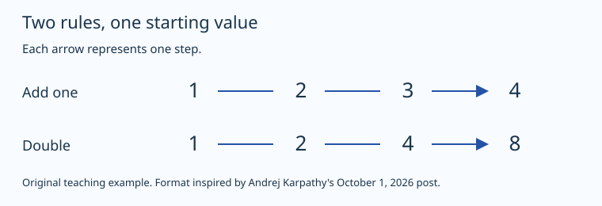

# One topic in four formats: repeated growth

This is a synthetic teaching example. Both sequences start at 1. Each step either adds 1 or multiplies the previous value by 2. The example uses elementary arithmetic, with no financial or scientific prediction.

## Prose

After `n` steps, adding one gives `1 + n`. Doubling gives `2^n`. At six steps, the values are 7 and 64. The starting value and step count are the same; the rule is what changes.

## Diagram

Text equivalent: adding one produces 1, 2, 3, 4. Doubling produces 1, 2, 4, 8. Each arrow represents one step. Read [diagram.svg](diagram.svg) for the original source.

## Interactive HTML

Download [index.html](index.html) and open it in a browser. Enter a whole number from 0 through 10. The page shows the values, formulas, a table, and a chart. It makes no network requests and uses no external dependencies.

## Video plan

Read [storyboard.md](storyboard.md) for scenes, narration, and a transcript. It is a plan for a short video, not a rendered video. The numbers match the prose and interactive example.

## What each format adds

The prose makes the rule and result easy to quote. The diagram makes the two sequences easy to compare. The interactive page lets the reader explore the difference. The storyboard gives a guided sequence that could be rendered with motion and narration.

Format inspiration: [Karpathy's original post](https://x.com/karpathy/status/2105819303471976479). The example and diagram are original project material. See [SOURCES.md](../../SOURCES.md) and [licenses](../../README.md#contents-and-reuse).
